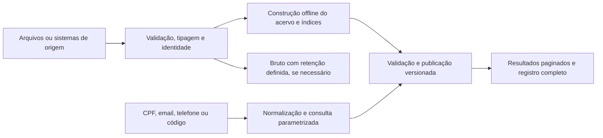

# Pesquisa e base de arquitetura

Pesquisa técnica de referência para Linux e acervos textuais estáticos, com **busca exata por CPF, e-mail, telefone ou código**. O cenário de 20 bilhões de registros é uma hipótese de dimensionamento usada nos exemplos; não representa capacidade comprovada nem um acervo real publicado.

## Recomendação para a carga confirmada

**A prioridade é um acervo estático com quatro caminhos de busca exata. SQLite somente leitura passa a ser o primeiro candidato à prova de conceito, comparado com PostgreSQL.** Preparação, importação e indexação acontecem antes da publicação; o serviço consulta arquivos finalizados. Isso reduz a relevância da concorrência de escrita na escolha, mas não elimina o custo de índices, I/O, roteamento e recuperação. É recomendação para testar, sem capacidade comprovada em 20 bilhões. [SQLite — usos apropriados](https://www.sqlite.org/whentouse.html), [SQLite — abertura somente leitura](https://www.sqlite.org/uri.html), [PostgreSQL — B-tree](https://www.postgresql.org/docs/current/indexes-types.html).

Ainda faltam tamanho dos registros, quantidade de resultados por identificador, prazo de preparação inicial, retenção, concorrência e meta de latência. O total de linhas, isoladamente, não permite escolher o banco nem prometer um tempo de resposta. O [desenho de busca](busca-identificadores.md) detalha os índices; o [plano SQLite](sqlite-somente-leitura.md) explica publicação e arquivos. As demais alternativas abaixo continuam como referência.

## Comparativo das opções

As indicações abaixo são inferências de adequação a partir das capacidades documentadas, sem benchmark deste projeto.

| Opção em Linux | Quando entra na seleção | Principal compromisso |
| --- | --- | --- |
| SQLite somente leitura | Acervo preparado previamente e consultado localmente por uma aplicação | Preparar, publicar e replicar arquivos é responsabilidade da solução; múltiplos arquivos exigem roteamento por todos os identificadores. |
| PostgreSQL | Usuários, vendas transacionais, unicidade, alterações e consultas por índices | Particionamento é local; carga analítica ampla disputa recursos com a operação. Mais partições só ajudam quando o acesso permite eliminá-las. |
| PostgreSQL + Citus | SQL distribuído quando a carga pode ser localizada por empresa/cliente ou outra chave | A chave de distribuição condiciona JOINs e unicidade; consultas entre nós têm restrições. |
| ClickHouse | Histórico com muitas inserções, filtros, somas e agrupamentos | A ordenação física precisa acompanhar as consultas. Chave primária esparsa não impõe unicidade como no PostgreSQL. |
| StarRocks | Análise SQL com JOINs e mudanças frequentes no estado de registros | Primary Key tables e índices persistentes exigem capacidade adicional; mais componentes de operação. |
| Apache Doris | Análise SQL com upserts, modelos de detalhe/agregado e JOINs | Escolher corretamente Duplicate/Unique/Aggregate Key; a semântica analítica não substitui automaticamente OLTP. |
| ScyllaDB | Leituras previsíveis por chave e escrita distribuída | Modelagem orientada às consultas, sem JOINs CQL; acessos diferentes podem exigir tabelas duplicadas. Avaliar licença e custo. |
| TiDB | Transações SQL distribuídas e escala horizontal de escrita como requisito | Camadas SQL/coordenação/armazenamento e replicação aumentam operação e consumo de recursos. |
| OpenSearch | Busca exata com campos keyword ou busca textual quando necessária | Medir armazenamento e fan-out de shards; é alternativa de índice distribuído, sem necessidade de análise linguística para CPF/email/telefone. |

Fundamentos: [SQLite — usos](https://www.sqlite.org/whentouse.html), [PostgreSQL — índices](https://www.postgresql.org/docs/current/indexes-types.html), [PostgreSQL — particionamento](https://www.postgresql.org/docs/current/ddl-partitioning.html), [Citus — DDL](https://docs.citusdata.com/en/stable/develop/reference_ddl.html), [Citus — restrições SQL](https://docs.citusdata.com/en/stable/develop/reference_workarounds.html), [ClickHouse — MergeTree](https://clickhouse.com/docs/reference/engines/table-engines/mergetree-family/mergetree), [StarRocks — Primary Key tables](https://docs.starrocks.io/docs/table_design/table_types/primary_key_table/), [Doris — arquitetura e modelos](https://doris.apache.org/docs/3.x/gettingStarted/what-is-apache-doris/), [ScyllaDB — modelagem](https://docs.scylladb.com/stable/get-started/data-modeling/query-design.html), [TiDB — arquitetura](https://pingcap.github.io/tidb-dev-guide/understand-tidb/introduction.html), [OpenSearch — campo text](https://docs.opensearch.org/latest/mappings/supported-field-types/text/).

**Primeira rodada atualizada:** quatro buscas exatas em SQLite somente leitura versus PostgreSQL, com os mesmos dados e resultados. ClickHouse com projeções leves, Citus, ScyllaDB e OpenSearch são opções para ampliar a comparação se o ensaio identificar um limite concreto. StarRocks/Doris e TiDB perdem prioridade, pois atualizações e transações distribuídas não foram apresentadas como requisitos.

Druid foi examinado, mas fica fora dessa primeira rodada: é mais alinhado a eventos temporais e agregações; substitui intervalos de dados e não atualiza registros individuais por chave primária. Trino + Iceberg é alternativa para um grande arquivo analítico em object storage, exigindo catálogo e operação próprios; não substitui diretamente um serviço de cadastro com leituras pontuais. [Druid — atualização de dados](https://druid.apache.org/docs/latest/ingestion/update-existing-data.html/), [Trino — conector Iceberg](https://trino.io/docs/current/connector/iceberg.html).

## Texto de entrada e modelo de dados

Receber CSV, JSON ou arquivos de texto não exige que todas as colunas do banco sejam texto. Separar os tipos de entidade, definir um contrato por origem e converter os campos cujo significado é conhecido. Colunas tipadas favorecem semântica correta e compressão. [ClickHouse — tipos de dados](https://clickhouse.com/docs/concepts/best-practices/select-data-type).

| Campo ilustrativo | Representação proposta | Regra |
| --- | --- | --- |
| CPF, telefone, CEP, código externo | Texto | Preservar zeros e regras da origem; não usar conversão numérica indiscriminada. |
| Nome, endereço, observação | Texto | Definir normalização e, separadamente, necessidade de busca textual. |
| Data da venda | Timestamp com convenção explícita de fuso | Validar o fuso de origem; manter instante canônico e informação local quando necessária. |
| Valor de venda | Decimal exato ou inteiro na menor unidade definida | Definir moeda, escala e arredondamento; evitar ponto flutuante para valores que exigem exatidão. |
| Status e categoria | Texto categórico | Avaliar representação compacta depois de medir cardinalidade. |
| Identificador interno | Tipo com faixa suficiente | 20 bilhões ultrapassam um inteiro de 32 bits; códigos externos continuam seguindo sua semântica. |
| Origem, versão, instante de ingestão | Colunas explícitas | Permitir rastreamento, reprocessamento e tratamento de duplicações. |

[PostgreSQL — tipos numéricos e valores exatos](https://www.postgresql.org/docs/current/datatype-numeric.html).

Preservar o bruto, quando necessário para reprocessar, em uma área com retenção definida e acesso controlado. Evitar repetir todos os dados pessoais em cada linha de venda: um identificador de usuário pode bastar. Se o relatório precisar do perfil na data da venda, modelar essa versão histórica; associar somente o cadastro atual mudaria o significado do resultado.

Não misturar usuários, vendas e documentos diferentes em uma tabela genérica com uma única coluna de texto. Um envelope bruto pode existir na entrada; as tabelas consultáveis devem refletir cada entidade e seus filtros.

## Arquitetura evolutiva proposta



O diagrama apresenta preparação e consulta separadas. SQLite pode manter registros e índices nos mesmos arquivos. A variante distribuída pode separar lookup estreito e conteúdo por ID, adicionando uma segunda leitura e um protocolo de publicação. Para mudanças muito raras, preparar uma versão nova fora do serviço e trocar o manifesto, preservando a versão das consultas em andamento.

Implementação proposta por etapas:

1. Ingestor lê em fluxo e lotes, sem carregar arquivos inteiros na RAM. Registra origem, checksum, versão de esquema e checkpoints.
2. Validação isola linhas inválidas com motivo e referência à origem. Normalização mantém o valor original quando sua recuperação for necessária.
3. Chave de idempotência identifica reenvios do mesmo registro/evento. Garantias de retry do banco precisam ser verificadas por engine e configuração.
4. Publicar registros e seus caminhos de consulta com garantia de consistência. Em duas estruturas distribuídas, registrar progresso, reprocessar de forma idempotente e reconciliar índices antes de declarar um lote pronto.
5. Usar fila como Kafka apenas quando necessidade de buffer, replay ou consumidores independentes justificar o custo operacional.

O ClickHouse recomenda lotes síncronos de pelo menos 1.000 linhas, preferencialmente de 10.000 a 100.000, como ponto de partida. Ajustar pelo tamanho em bytes, quantidade de partições tocadas e pressão dos merges. [Estratégias de inserção](https://clickhouse.com/docs/concepts/best-practices/selecting-an-insert-strategy).

## Consultas e organização física

**Busca exata:** definir quais identificadores serão consultados, em que escopo e com que normalização. Usar índices e confirmar o plano. `CPF = valor` e `texto contém uma palavra` são operações diferentes. No OpenSearch, `keyword` representa correspondência exata e `text` passa por análise textual. [Keyword](https://docs.opensearch.org/latest/mappings/supported-field-types/keyword/), [Text](https://docs.opensearch.org/latest/mappings/supported-field-types/text/).

**SQLite:** criar índices por identificador na preparação, validar o plano e abrir o arquivo publicado com `mode=ro`. `immutable=1` só cabe se o arquivo não mudar enquanto aberto; esse modo desativa locks e detecção de mudanças. Publicar nova versão em outro caminho em vez de alterar o arquivo servido. O [plano de acervo estático](sqlite-somente-leitura.md) detalha limites e divisão por arquivos. [SQLite — URI](https://www.sqlite.org/uri.html), [planejamento](https://www.sqlite.org/queryplanner.html).

Para o requisito confirmado, testar cada campo independentemente. Um índice composto `(cpf, email, telefone)` não equivale a três índices independentes. O identificador pode corresponder a muitos registros e não deve ser declarado único sem regra de negócio. [PostgreSQL — índices multicoluna](https://www.postgresql.org/docs/current/indexes-multicolumn.html).

**PostgreSQL:** B-tree é candidato para igualdade e intervalos; BRIN pode ajudar campos correlacionados com a posição física, como tempo em histórico ordenado. Particionar por período só quando filtros e ciclo de vida justificarem. PK/UNIQUE de tabela particionada precisam incluir a chave de particionamento; Citus também condiciona unicidade à coluna de distribuição. Não presumir email globalmente único após dividir usuários por data/empresa. [Índices](https://www.postgresql.org/docs/current/indexes-types.html), [BRIN](https://www.postgresql.org/docs/current/brin.html), [particionamento](https://www.postgresql.org/docs/current/ddl-partitioning.html), [Citus DDL](https://docs.citusdata.com/en/stable/develop/reference_ddl.html).

**ClickHouse:** desenhar `ORDER BY` pelos filtros mais usados e medir `EXPLAIN indexes = 1`, linhas e bytes lidos. Uma ordem ilustrativa `(empresa_id, data_venda, venda_id)` só faz sentido se as consultas correspondentes forem frequentes. Buscar apenas email em uma tabela ordenada assim pode exigir outra estrutura. A chave de partição serve principalmente à gestão dos dados; período mensal é hipótese, não regra. Evitar uma partição por usuário/CPF. [Ordenação](https://clickhouse.com/docs/concepts/best-practices/choosing-a-primary-key), [particionamento](https://clickhouse.com/docs/concepts/best-practices/partitioning-keys).

Para busca independente por CPF/email/telefone/código, avaliar projeções leves com chave e `_part_offset`, que permitem acessar dados da base sem copiar todo o conteúdo para cada ordenação. A versão 25.11 acrescentou pruning em granularidade de grânulos nesse mecanismo. Ainda é preciso medir análise dos índices, partes/grânulos e I/O por consulta. [Projeções](https://clickhouse.com/docs/concepts/features/projections/projections), [release 25.11](https://clickhouse.com/blog/clickhouse-release-25-11).

Há suporte atual a updates leves no ClickHouse; isso não elimina a necessidade de medir custo e semântica. `ReplacingMergeTree` deduplica durante merges e não oferece unicidade imediata em uma consulta simples. Relatórios sobre estados versionados precisam escolher explicitamente a versão atual. [UPDATE](https://clickhouse.com/docs/reference/statements/update), [ReplacingMergeTree](https://clickhouse.com/docs/reference/engines/table-engines/mergetree-family/replacingmergetree).

**Busca textual:** confirmar se o requisito é palavra, frase, prefixo, substring ou similaridade. `LIKE '%termo%'` em todo o acervo não é uma estratégia de capacidade. Comparar o recurso nativo antes de adicionar outro serviço: PostgreSQL possui `pg_trgm`; ClickHouse documenta índices textuais GA a partir da versão 26.2. Testar semântica de acentos, idioma e termos comuns, além do tempo de consulta. [pg_trgm](https://www.postgresql.org/docs/18/pgtrgm.html), [índices textuais ClickHouse](https://clickhouse.com/docs/reference/engines/table-engines/mergetree-family/textindexes).

Agregados materializados e índices adicionais devem corresponder a consultas reais. Cada estrutura acrescenta bytes e trabalho de ingestão. Exportações grandes devem usar execução assíncrona e leitura em fluxo; navegação interativa deve ter limite e paginação por chave/cursor.

## Dimensionamento inicial

**Medir bytes UTF-8, não quantidade de caracteres.** Os cenários abaixo tratam da soma lógica de bytes antes de compressão, sem índices, metadados, cópias ou backups. Não são resultados medidos.

| Média lógica por registro | 20 bilhões de registros |
| --- | ---: |
| 200 bytes | 4 TB |
| 1.000 bytes | 20 TB |
| 5.000 bytes | 100 TB |
| 20.000 bytes | 400 TB |

TB = 10¹² bytes; TiB = 2⁴⁰ bytes. Medir média, p95 e máximo em amostra representativa de cada entidade. Texto longo e valores distintos podem ter compressão muito diferente de categorias repetidas. A amostra deve usar a mesma definição de bytes que alimenta a calculadora; tamanho de CSV/JSON inclui delimitadores e nomes que podem não existir no armazenamento tipado.

Limites físicos também importam: o PostgreSQL documenta 32 TB por relação com páginas padrão de 8.192 bytes; isso não limita o banco inteiro nem a soma de partições de uma tabela lógica. Textos grandes podem ir para TOAST, cujo limite teórico por tabela é de 2³² valores externos, com limitações práticas anteriores. Se houver muitos textos longos, testar esse comportamento e considerar particionamento desde o desenho. [Limites oficiais PostgreSQL](https://www.postgresql.org/docs/current/limits.html).

A [calculadora](../scripts/estimate_capacity.py) usa:

```text
logico = linhas × bytes_medios
comprimido = logico / fator_de_compressao
uma_copia = comprimido × (1 + overhead_percentual / 100)
cluster_provisionado = uma_copia × copias_totais / (1 - folga_percentual / 100)
backups_separados = uma_copia × copias_de_backup
```

`copias_totais = 2` significa duas cópias no total. Não significa original mais duas réplicas. A folga usa divisão: deixar 30% livre é diferente de acrescentar 30% ao espaço ocupado. A estimativa é para o conjunto dos nós de dados; a quantidade de shards só será definida depois dos testes de CPU, memória, disco e rede.

Exemplo hipotético com 1.000 bytes/linha, compressão 3:1, overhead 25%, duas cópias e 30% livre: **20 TB lógicos → 6,67 TB comprimidos → 8,33 TB por cópia → 23,81 TB provisionados**, mais **8,33 TB** para um backup completo separado. Não usar compressão 3:1 como garantia, especialmente ao comparar motores de armazenamento diferentes.

Orçar à parte: bruto retido, WAL/logs, fila, índices de busca externos, tabelas derivadas, versões e tombstones além do overhead estimado, retenção incremental dos backups, espaço temporário de reconstrução, coordenação e margem de crescimento. O espaço de merges e de recuperação precisa ser medido; 30% é apenas cenário. O cálculo não inclui o custo de RAID ou redundância do provedor que não esteja embutido na capacidade útil contratada.

O total acumulado também difere da taxa de ingestão: carregar 20 bilhões em 24 horas exige em média **231.481 registros/s**; acumular a mesma quantidade em 365 dias corresponde a **634 registros/s**. Picos, bytes por segundo, atualizações, índices e consultas simultâneas podem dominar o custo. Isso é aritmética, não capacidade comprovada de um banco.

## Linux, disponibilidade e custo

Escolher uma distribuição Linux suportada pela versão exata do motor; fixar versão de produção e política de atualização. Para o piloto, medir CPU, RAM, I/O e espaço com o mesmo esquema previsto para produção. NVMe para dados consultados com frequência é hipótese a comparar com a alternativa de custo; não há especificação de compra justificável apenas pelo número de linhas. O ClickHouse publica recomendações de RAM, armazenamento e filesystem para instalação própria. [Recomendações operacionais](https://clickhouse.com/docs/guides/oss/best-practices/tips).

Shards dividem os dados; réplicas mantêm cópias. Aumentar réplicas não divide automaticamente o volume de uma cópia. Um cluster ClickHouse OSS replicado pode usar `ReplicatedMergeTree` e um quorum de Keeper; o exemplo oficial usa duas réplicas de dados e três Keeper. A topologia e os domínios de falha precisam acompanhar a disponibilidade desejada. [Exemplo de replicação](https://clickhouse.com/docs/guides/oss/deployment-and-scaling/examples/1-shard-2-replicas).

Replicação e backup têm propósitos diferentes: exclusões e erros podem se propagar às réplicas. Definir perda máxima tolerada (RPO), prazo de recuperação (RTO), backup separado e teste de restauração com verificação do conteúdo. PostgreSQL oferece backup físico e arquivamento contínuo/PITR; validar o método no volume real. [ClickHouse — backup](https://clickhouse.com/docs/concepts/features/backup-restore/overview), [PostgreSQL — backup](https://www.postgresql.org/docs/current/backup.html).

Para dados de usuários, incluir desde o desenho: credenciais fora do repositório, acesso por função, conexão protegida, trilha de acesso, redução de dados pessoais nos logs, retenção e procedimento de exclusão também nas cópias derivadas. Esses requisitos afetam consultas, índices e operação.

Comparar hospedagem com a mesma quantidade de cópias, capacidade útil e disponibilidade. Custo total inclui máquinas, discos, backup, transferência, licenças/suporte e horas de operação. Mais motores significam mais rotinas de atualização e recuperação; o benefício deve aparecer no teste.

## Licenciamento e decisões pendentes

PostgreSQL usa a PostgreSQL License; Citus declara AGPLv3; os repositórios de ClickHouse, StarRocks, Doris e TiDB declaram Apache 2.0. Produtos gerenciados e componentes comerciais têm condições próprias. Conferir o artefato e a versão contratados. [PostgreSQL](https://www.postgresql.org/about/licence/), [Citus](https://github.com/citusdata/citus/blob/main/LICENSE), [ClickHouse](https://github.com/ClickHouse/ClickHouse/blob/master/LICENSE), [StarRocks](https://github.com/StarRocks/starrocks/blob/main/LICENSE.txt), [Doris](https://github.com/apache/doris/blob/master/LICENSE.txt), [TiDB](https://github.com/pingcap/tidb/blob/master/LICENSE).

A licença source available atual da ScyllaDB tem condições de elegibilidade e limites de uso de 10 TB de armazenamento disponível agregado e 50 vCPUs no uso gratuito descrito. Não presumir uso gratuito ilimitado para esse projeto; verificar o contrato exato e incluir eventual licença no orçamento. [Contrato oficial ScyllaDB](https://www.scylladb.com/scylladb-software-license-agreement/).

Antes do esquema definitivo, registrar:

- Quatro buscas por igualdade, uma por identificador, seus filtros adicionais, quantidade retornada e metas de latência p95/p99.
- Tamanho médio/p95/máximo por entidade, quantidade de usuários e distribuição de vendas por usuário/empresa.
- Prazo para importar, indexar e validar a base inicial; deduplicação desejada e frequência de eventual nova versão. Definir separadamente retenção e eventuais exclusões.
- Consultas simultâneas e semântica de versão das páginas durante eventual troca de acervo.
- Retenção por entidade, volume consultado com frequência, RPO/RTO e orçamento mensal ou de aquisição.

O [plano de prova de conceito](plano-benchmark.md) é o próximo passo para transformar essa pesquisa em decisão e infraestrutura mensuradas.
